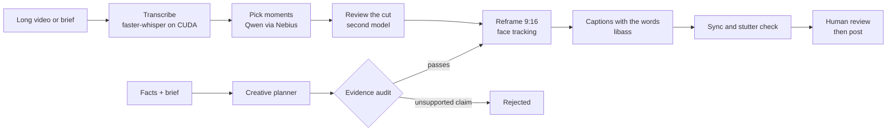

# Shortsmith

My own AI video studio. It turns long footage into vertical shorts, writes original short-form ads from checked facts, and since November 2026 it can put my own face and voice on my own content.

The code lives in a private repo because it runs a small content business. This page explains how it works.

## What it does

- **Clipper.** Transcribes long video on the GPU, lets a model pick the strongest moments, follows the speaker's face into a 9:16 frame and burns in captions that appear with the words. Every stage is cached, so changing one clip re-renders only that clip.
- **Creative planner.** Turns a fact ledger, a campaign brief and reference research into shot-by-shot concepts. It fails closed: a separate evidence audit rejects any script with a claim, number or price that is not in the facts. Missing evidence is never invented.
- **Face pipeline.** Lip-syncs a new script onto my own recorded footage, locally on an RTX 4060, at zero cost per video. Used only for my own content, with the AI label on.
- **Feedback loop.** Posts are judged by retention, follows and sales, not raw views, and the next concepts learn from that.

## How a clip is made

## Rules it follows

- Only footage I am licensed to use: a campaign pack or the creator's written yes.
- Paid clips are labelled `#ad`. No gambling campaigns.
- Nothing posts before it passes my own edit standard and a manual check on a phone.
- Audio stays locked to its picture; sync is measured before delivery.

## Stack

Python, faster-whisper, Nebius Token Factory (Qwen, Kimi), FFmpeg and libass, MediaPipe face tracking, MuseTalk, pytest (117 tests).

## Who

Danila Popusoi, final-year BSc Artificial Intelligence at VU Amsterdam. [github.com/Danila1801](https://github.com/Danila1801)
